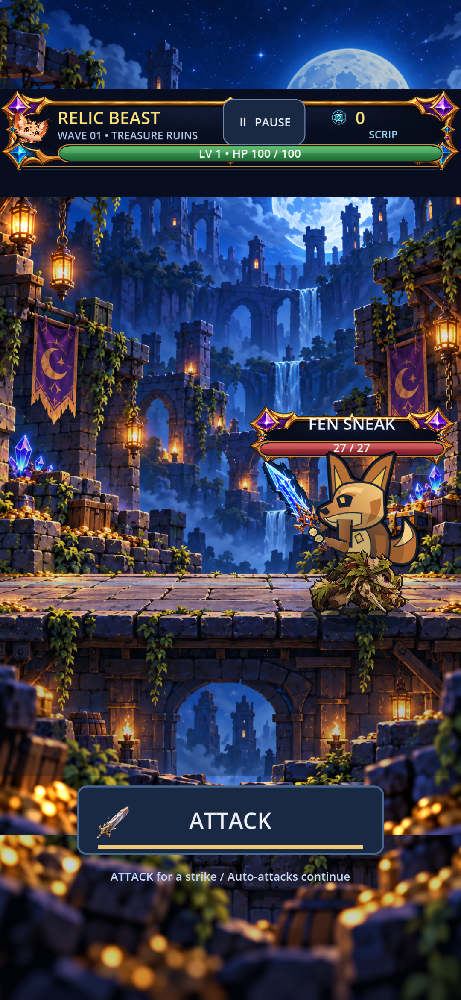
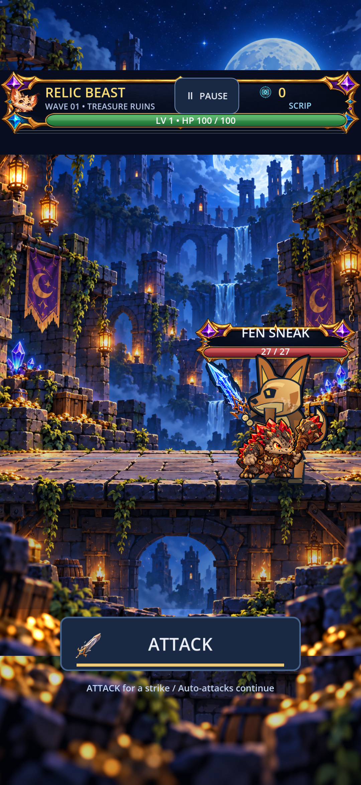
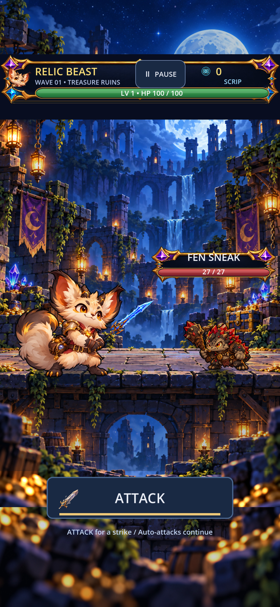
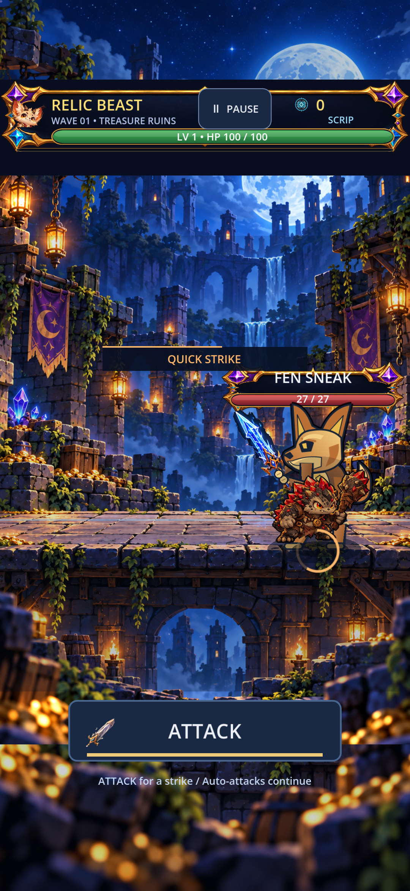
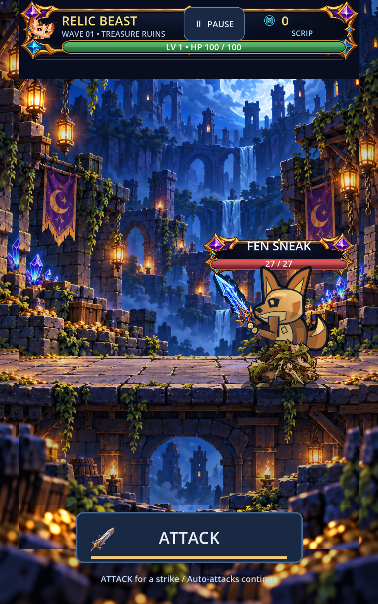
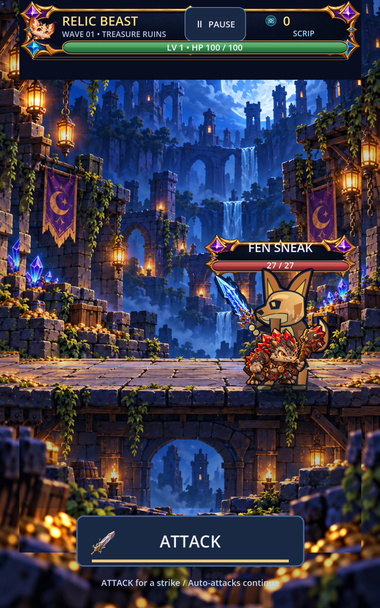
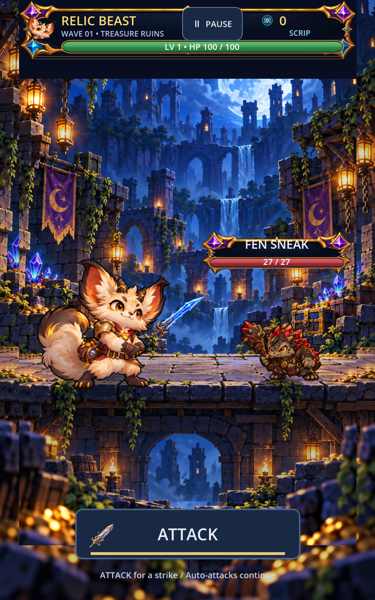
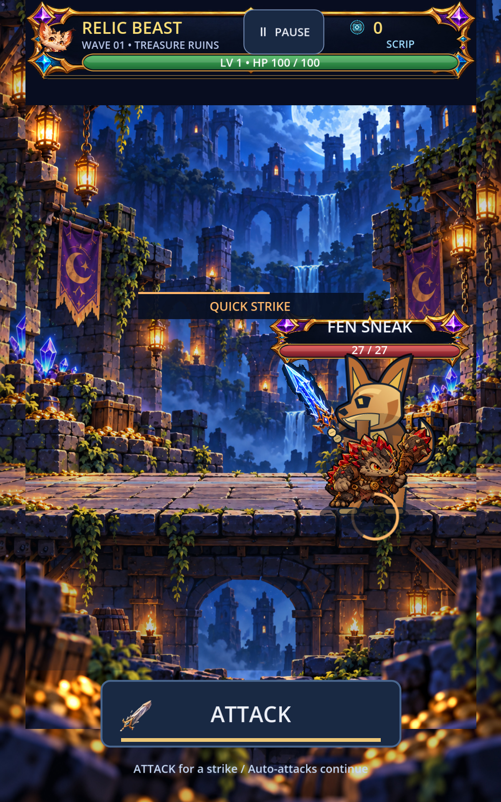

# Approved-source runtime evidence

These are synthetic target-side fixtures, not evidence that normal combat lane staging or the Relic Beast TEMP body is accepted. Fen Sneak right-neutral is the only new production frame. OPEN captures prove it is not substituted into windup, hurt or opposite-facing states. Phone 1080x2340; tablet 1200x1920; original full-size captures retained in ignored native output.

