# Canon-lock Archive before / after

Twenty full-resolution native Godot captures: all five accepted Wanderers, phone 1080×2340 and tablet 1200×1920. Existing full-body thumbnails before; accepted HUD atlas portraits after. Isolated saves; JPEG94, no resize or art repaint.

## native/1080x2340/after/archive_ashtrail_hunter.jpg

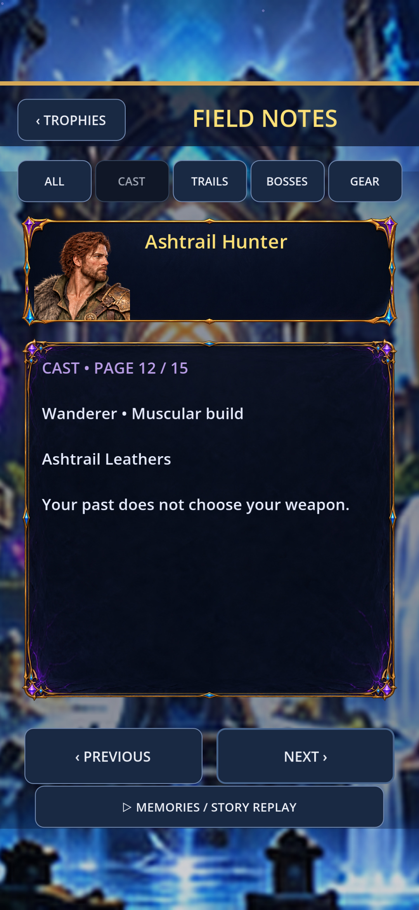

## native/1080x2340/after/archive_nightstage_drifter.jpg

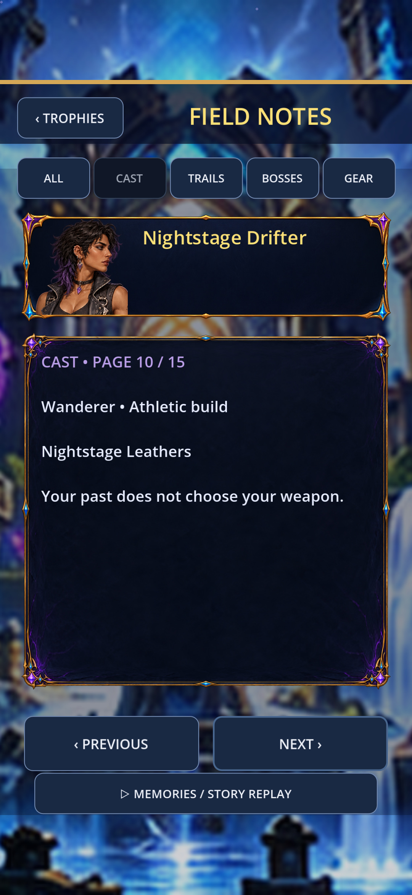

## native/1080x2340/after/archive_ruin_warden.jpg

## native/1080x2340/after/archive_vault_runner.jpg

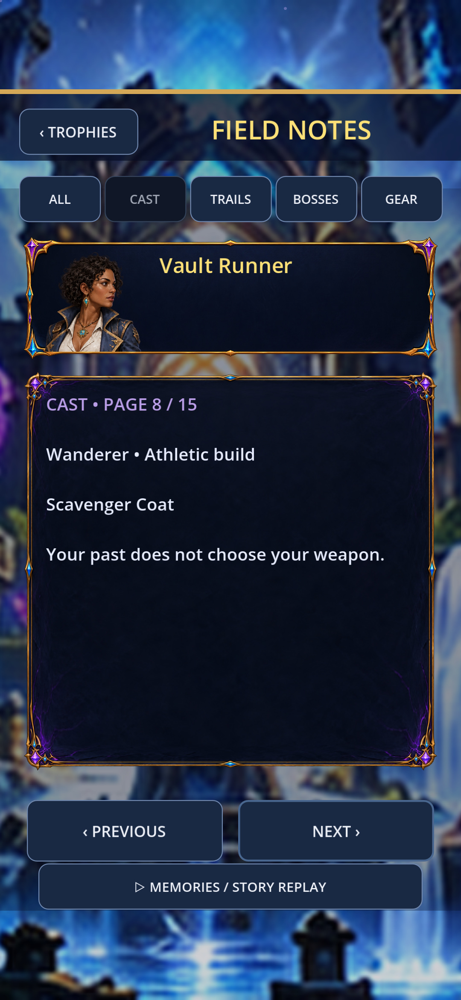

## native/1080x2340/after/archive_velvet_astrologer.jpg

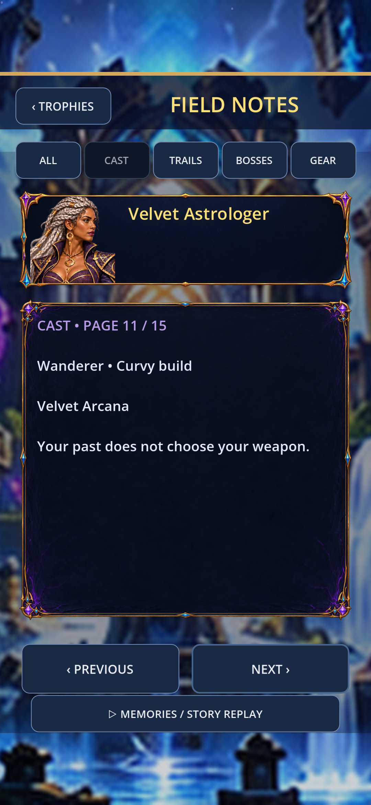

## native/1080x2340/before/archive_ashtrail_hunter.jpg

## native/1080x2340/before/archive_nightstage_drifter.jpg

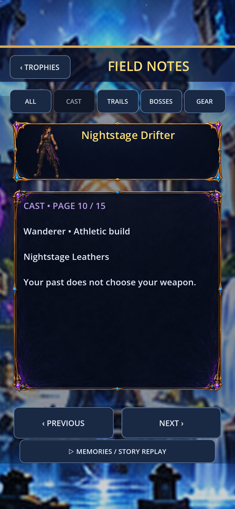

## native/1080x2340/before/archive_ruin_warden.jpg

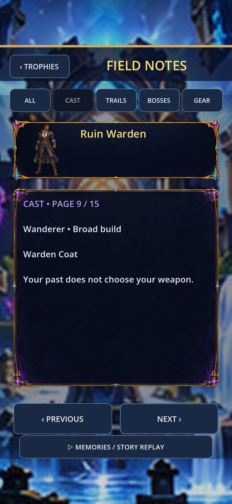

## native/1080x2340/before/archive_vault_runner.jpg

## native/1080x2340/before/archive_velvet_astrologer.jpg

## native/1200x1920/after/archive_ashtrail_hunter.jpg

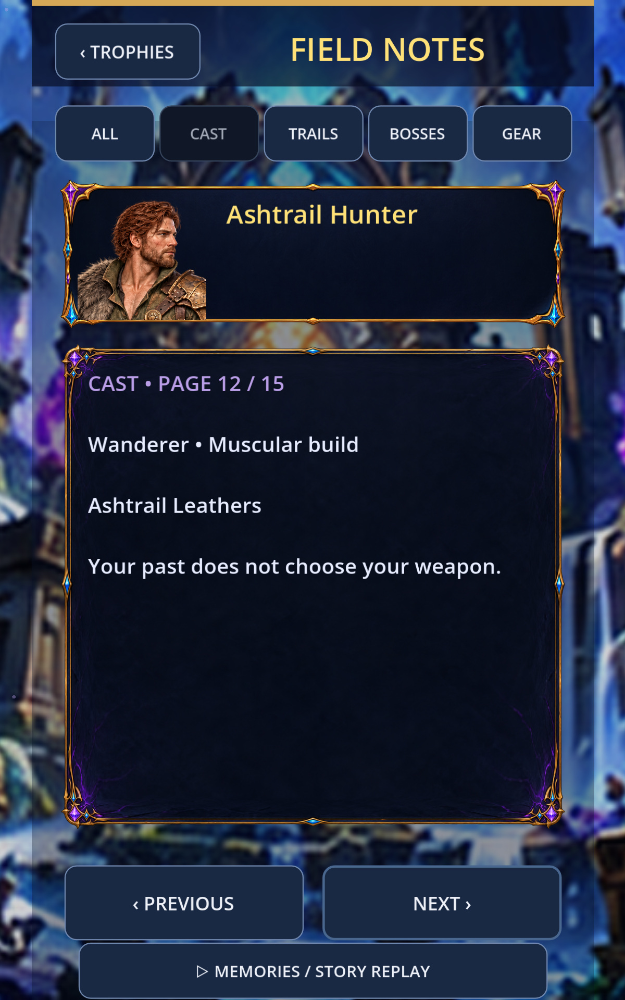

## native/1200x1920/after/archive_nightstage_drifter.jpg

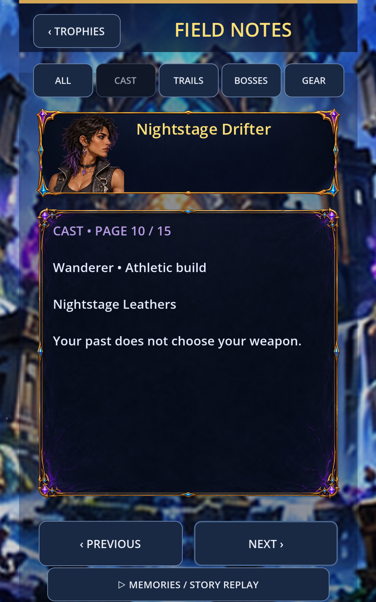

## native/1200x1920/after/archive_ruin_warden.jpg

## native/1200x1920/after/archive_vault_runner.jpg

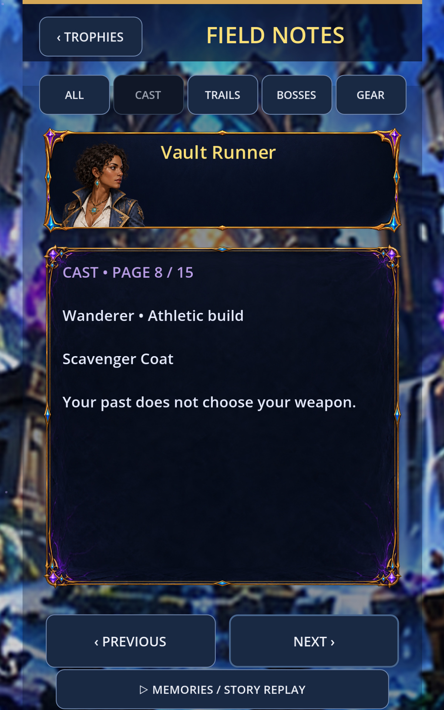

## native/1200x1920/after/archive_velvet_astrologer.jpg

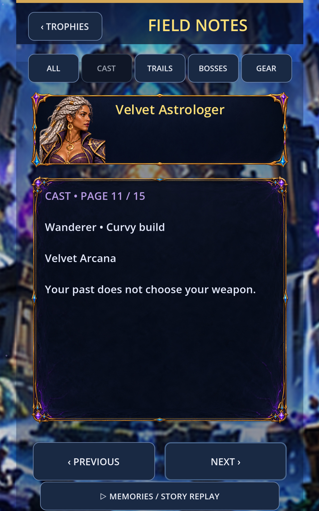

## native/1200x1920/before/archive_ashtrail_hunter.jpg

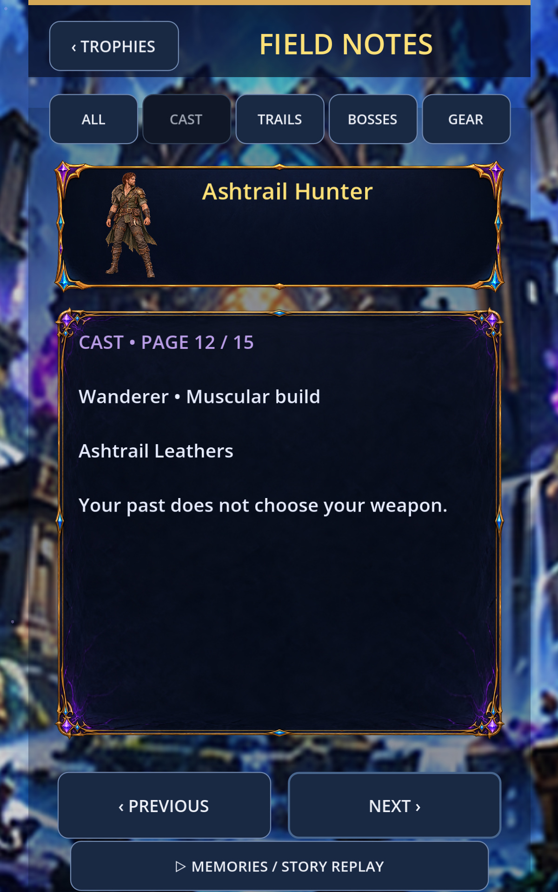

## native/1200x1920/before/archive_nightstage_drifter.jpg

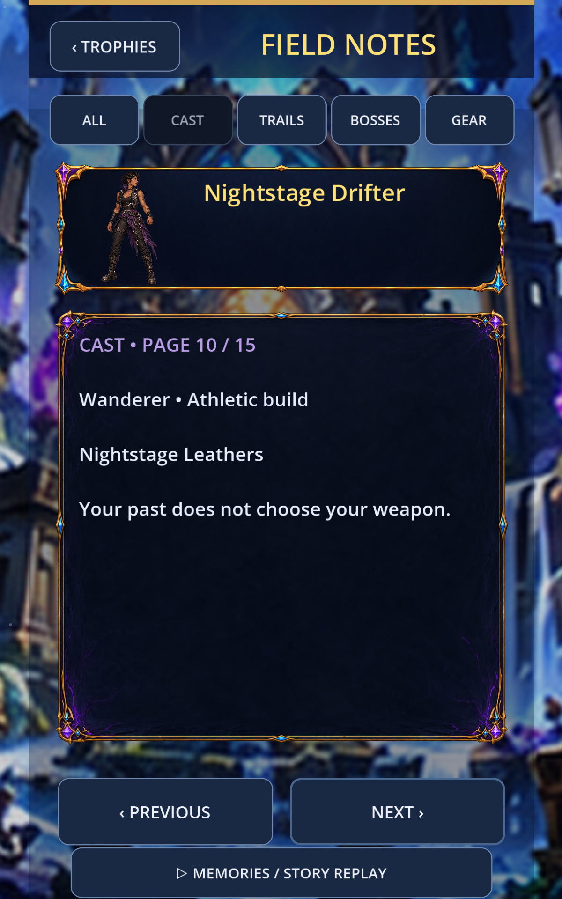

## native/1200x1920/before/archive_ruin_warden.jpg

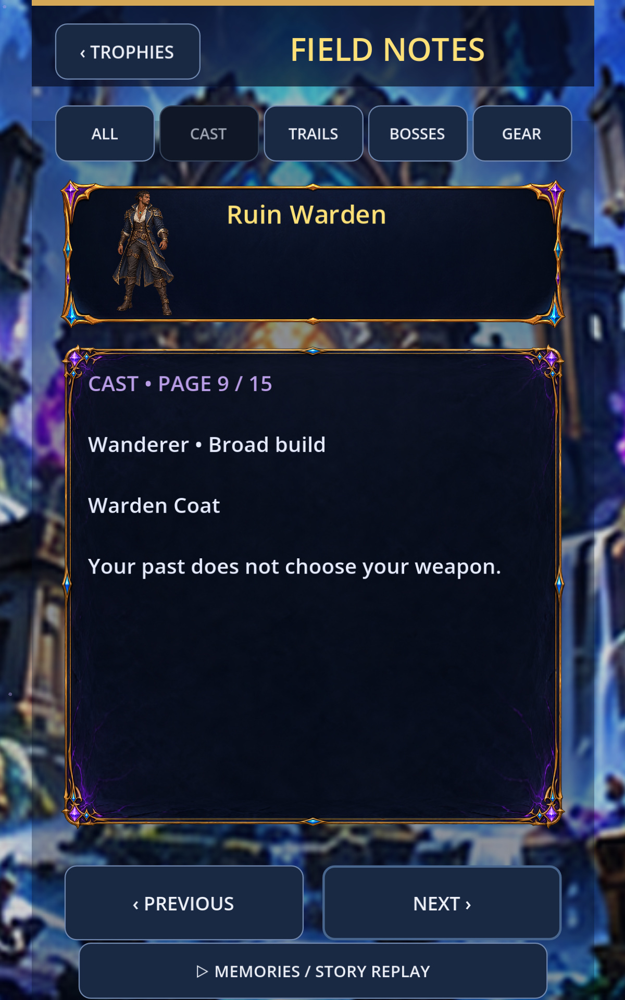

## native/1200x1920/before/archive_vault_runner.jpg

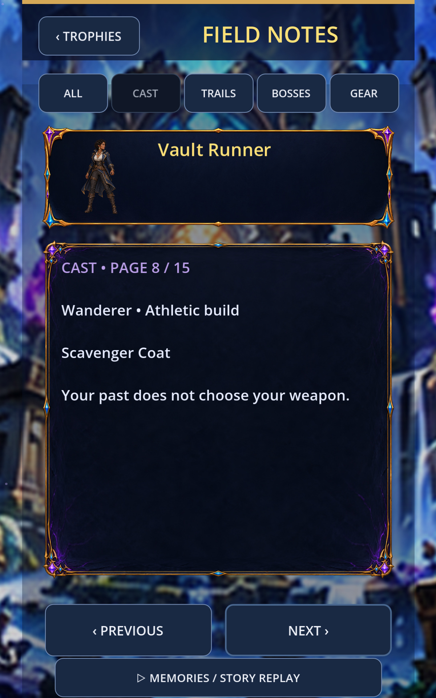

## native/1200x1920/before/archive_velvet_astrologer.jpg

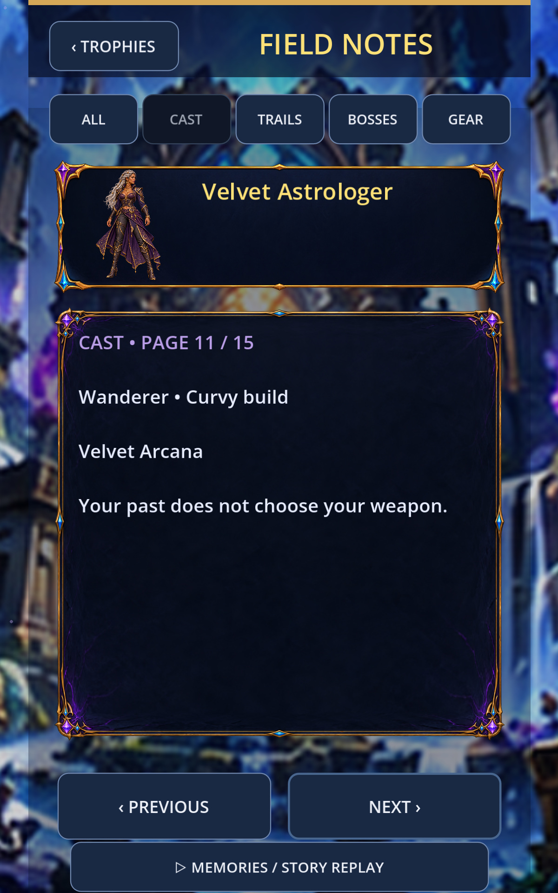
