# Gloomlet bow native evidence

Staged actual actor/target relationships; forced_facing_test=0. Not a completed expedition playthrough.

## 1080x2340 BOW_FIT_moonbranch_right

## 1080x2340 BOW_FIT_moonbranch_left

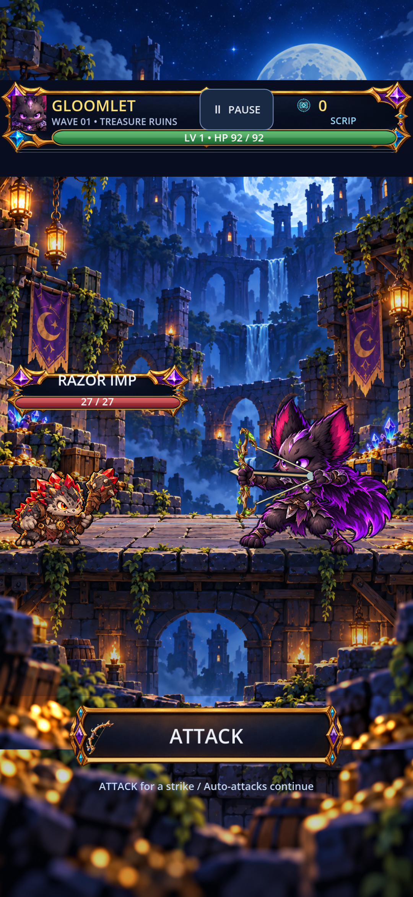

## 1080x2340 BOW_FIT_gilded_shortbow_right

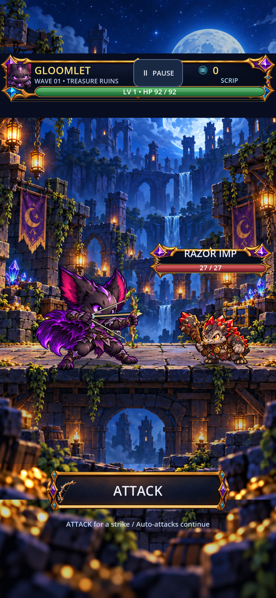

## 1080x2340 BOW_FIT_gilded_shortbow_left

## 1080x2340 long_names_2_enemies

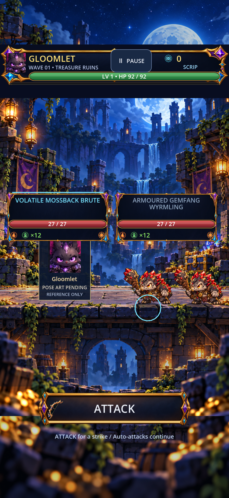

## 1080x2340 long_names_3_enemies

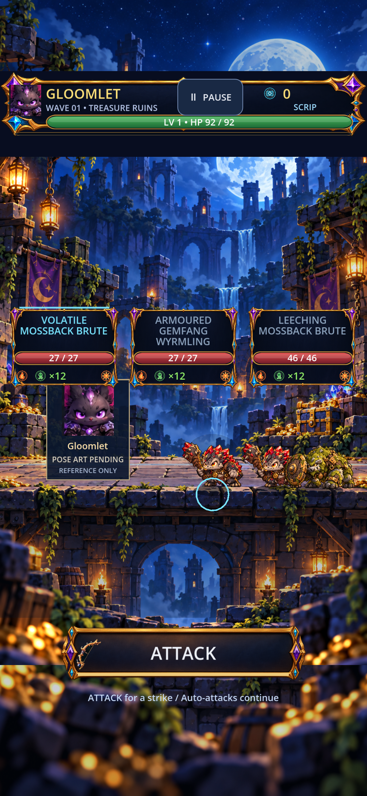

## 1080x2340 attack_control_ready

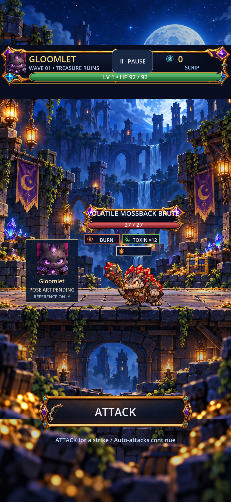

## 1080x2340 BLOCKED_gloomlet_bow_idle_right

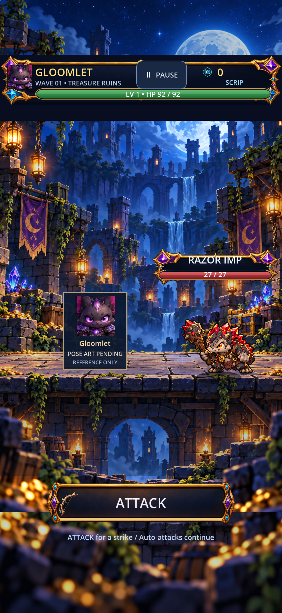

## 1200x1920 BOW_FIT_moonbranch_right

## 1200x1920 BOW_FIT_moonbranch_left

## 1200x1920 BOW_FIT_gilded_shortbow_right

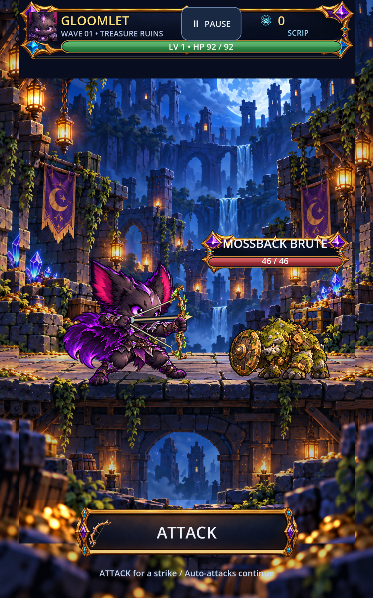

## 1200x1920 BOW_FIT_gilded_shortbow_left

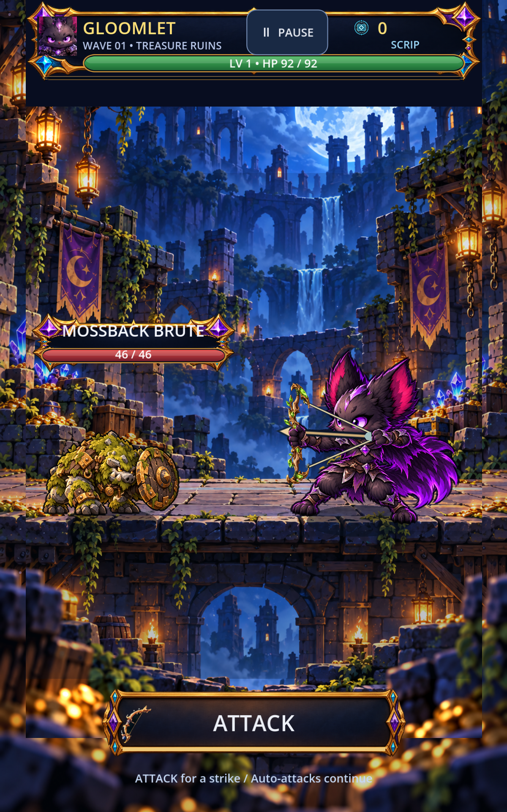

## 1200x1920 long_names_2_enemies

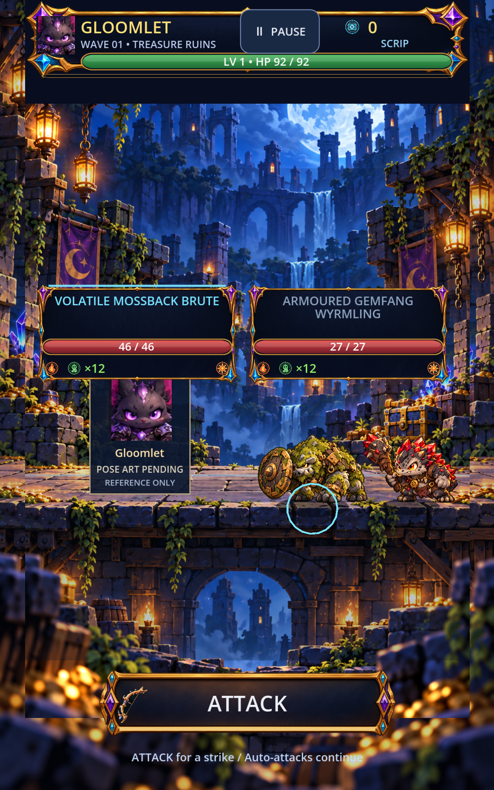

## 1200x1920 long_names_3_enemies

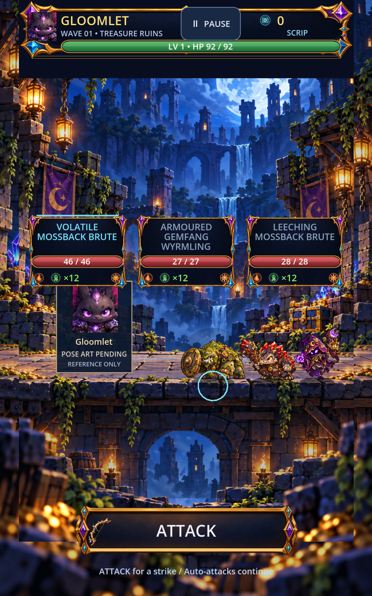

## 1200x1920 attack_control_ready

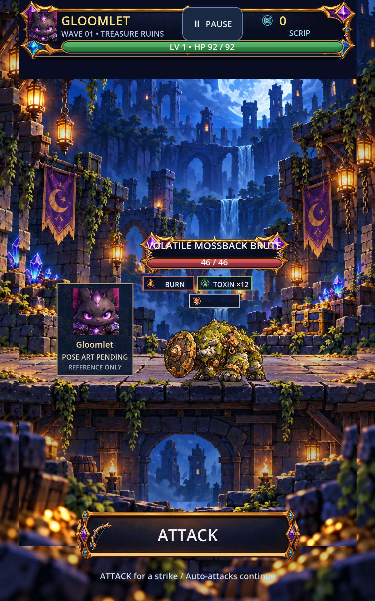

## 1200x1920 BLOCKED_gloomlet_bow_idle_right

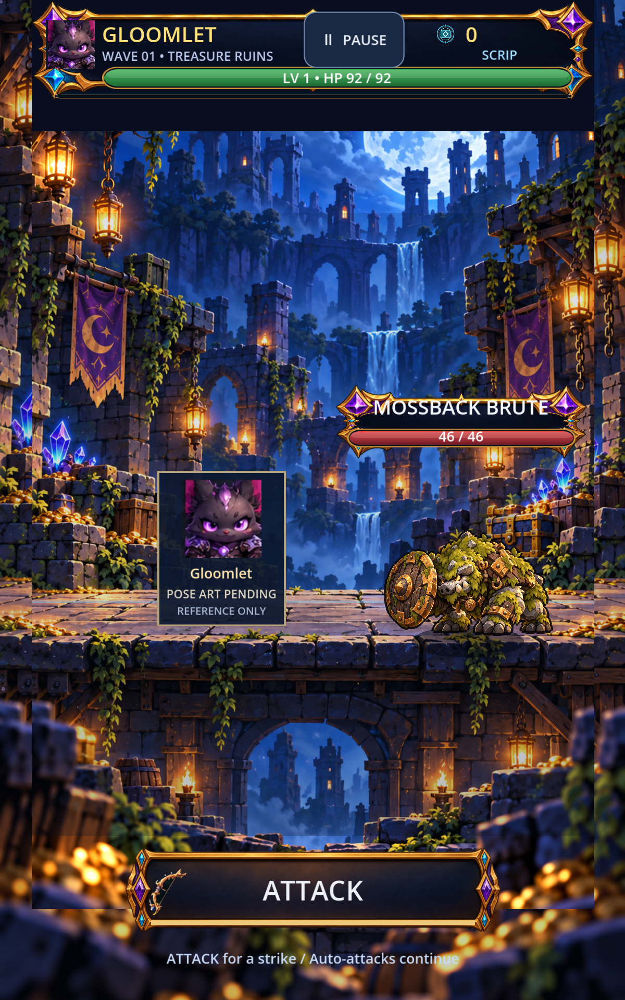

