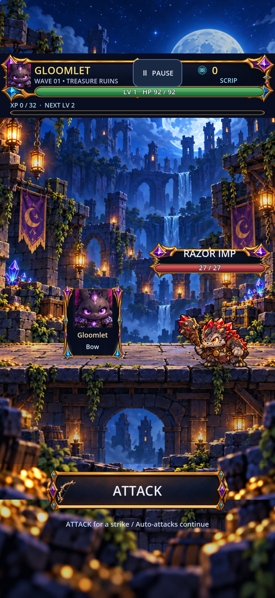
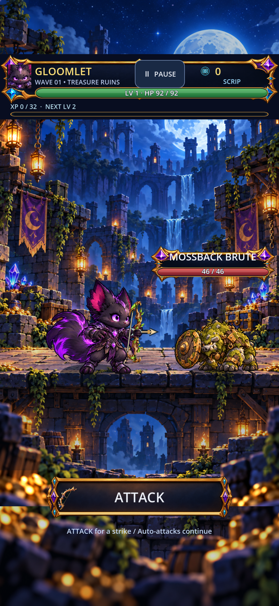

# 0.4.43 — real player combat bodies and connected rewards

Live production root: `C:\Users\Snkii\Documents\lootlings`; branch `codex/phase4e-gamefeel`. Base pushed 0.4.42 `6a15b57`. GitHub Issue #3 executed as a scoped delivery milestone; full-game professional completion remains open.

Gloomlet Bow gains real idle, release, follow-through, recovery and hurt bodies in both independently authored views. Accepted prior windups remain. Moonkip Wand gains idle/hurt both views and a true left windup. Moonkip Orb gains ten exact state/view deliveries using compatible weaponless bodies, including prior approved casting exports. Original dedicated Gloomlet and hooded cream Moonkip sheets govern identity; conflicting alternate Moonkip reference is preserved and excluded.

Modular weapon assets remain separate. Source-measured palms and foreground fingers keep the Bow/Wand at the hand; the released rear Bow paw stays released. Native review corrected resting weapon angles that obscured faces. Hurt now takes priority over recovery when choosing a body. Gameplay stats, attack timing, random state, economy and save formats are unchanged.

**25 new verified delivery contracts**: Gloomlet Bow 10; Moonkip Wand 5; Moonkip Orb 10. **15 new body PNGs +15 foreground-grip PNGs +25 sidecars =55 new physical artist files.** These fulfil 75 frozen artist-file requirements, including 20 compatible reused body/grip references. Raw source sheets and import cache files are not counted as finished artist deliveries. No new enemy/NPC animation closures are claimed in this milestone; prior 48 creature/resident keyframes are preserved and packaged-tested.

Single-find rewards now shrink from 630 to 370 local units; item artwork is contained within its card. Source and compiled touch routes verify Home, Hub/cart Shop, purchase once, Stash, Shrine, earned Spinner and empty-bank explanation, combat, perk selection, reward keep, results and natural return. Existing selection/merchant controls and title theme remain intact.

Native source and actual exported Windows PCK ran at 1080×2340, 1200×1920 and 1920×1080. Selected stationary/action probes: **108 before /108 after; reference fallback incidents 81→0**. Real attacks/projectile creation, unchanged timings/damage/random states and explicit movement fallback are checked. Save recovery and weapon-fit regressions pass. This is scoped probe coverage, not a claim of zero fallbacks gamewide or complete smooth multi-frame animation.

Rejected/corrected together: wrong-facing Moonkip left windup/cast; three-foot Moonkip recovery; source-edge Gloomlet follow-through; clipped-ear standalone windup. Valid earlier Gloomlet follow-through retained, padded true-left Moonkip windup corrected. Source records remain recoverable. No bad candidate closes a contract.

**Remaining frozen debt: 3,058 contracts /8,001 artist-file requirements.** Playable Lootlings 1,396; Wanderers 855; enemies 252; bosses 356; NPCs 34; support 165. Derived registry is a different denominator: 2,893 missing launch cells, after 25 new closures and reconciliation of 35 already installed casting states. ATTACK fallback never closes a distinct follow-through requirement. Dashboard retains 43 registration/dependency gaps and zero blanket professionally accepted records.

Movement, Moonkip separate follow-through, defeat/victory, remaining weapon families, Wanderer fitting, resident route/work/sit and complete animation continuity remain open. Regional/boss art, world grounding, Home/Hub cohesion, broad menu quality, perceptual audio listening and physical S23 review also remain. Next production pass should cover coordinated missing melee/player and enemy/resident families that directly remove live fallback states, preserving this milestone.

Candidates: `builds/android/Lootlings-0.4.43-player-combat-debug.apk` (version code 52; signed/aligned arm64 debug candidate), `builds/windows/Lootlings-0.4.43-player-combat.exe` plus adjacent PCK. Current manifests/body/grip textures verified in APK; approved launcher/adaptive/monochrome/splash resources and Windows 16–256px icons checked. Physical Android launch, listening and performance are pending. These are candidate builds, not final commercial acceptance.

Runtime changes: `authored_pose_manifest.gd`, `weapon_fit_catalog.gd`, `lootling.gd`, `export_presets.cfg`, `art/production/phase4e/player_batch_043_manifest.json` and its exact bodies/grip layers/sidecars. Deterministic export jobs, original sources/provenance, guarded QA, registry/dashboard builders and receipts are included. Owner's pre-existing `project.godot` edits and supplied untracked reference packages remain outside this checkpoint.

